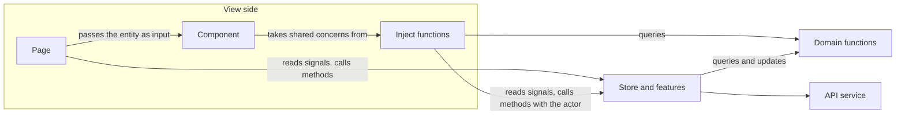

# Angular Signal Store Patterns

Where does the functional code around an NgRx Signal Store go, if not into the store itself and not into a `helpers/` folder?

Vue has composables, React has hooks. Angular with NgRx Signal Store splits the same idea into three layers. Which layer a piece of code belongs in depends on what it needs:

| The code needs… | Pattern | Vue / React analogue |
|---|---|---|
| nothing but its arguments | [Domain functions](01-domain-functions/) | a plain TS module |
| to change state or talk to the server | [Store methods and features](02-store-organisation/) (`withX()`) | a store |
| view context: who is looking, where to navigate | [Inject functions](03-component-access/) (`injectX()`) | a composable / hook |

"Helpers" stays reserved for code that knows nothing about your domain: strings, arrays, dates.

## From store to view



- **Domain functions** hold the rules: what a draft is, who may edit a post, what a post looks like after a like.
- **The store** holds the state and is the only place that changes it or talks to the server. Its methods take the actor as an argument, so it knows nothing about sessions or screens.
- **Pages** read the store directly and pass entities down as inputs.
- **Inject functions** add view context to rules and state that already exist: "the user is whoever is signed in", "anonymous users go to sign-in". One per concern, shared by every view that shows that concern.
- **Components** render, forward clicks, and keep whatever only they need.

Arrows only point one way. The store never imports from the view side, and domain functions import nothing at all.

## Where does it go?

**[WHERE-DOES-IT-GO.md](WHERE-DOES-IT-GO.md)** is the part to read if you worry that every developer will cut these layers differently. It has four yes/no questions that place any piece of code, naming rules that can be checked in review, two tests for "what is one concern", a table of red flags, and the lint rules that enforce the import boundaries.

## Options, side by side

Each chapter shows every option as real code in its own folder, all solving the same problem, so you can compare them directly. The chapter README explains the trade-offs and shows how the code is used.

| Chapter | Options | Recommended |
|---|---|---|
| [1. Domain functions](01-domain-functions/) | A companion object · B module namespace · C class | A (or B) |
| [2. Store organisation](02-store-organisation/) | A inline · B method factories · C store features · D features with callbacks · E events | C, plus D for generic features, and E when several stores or components react to the same thing |
| [3. From store to view](03-component-access/) | A logic in component · B view methods on store · C component service · D inject functions · E presentational component | D for domain components, E for UI pieces |

Later chapters build on the recommended option of earlier ones: chapter 2 uses the `Post` from `01-domain-functions/a-companion-object`, and chapter 3 uses the store from `02-store-organisation/c-store-features`.

## The example

A small blog: **posts** that signed-in **users** can like, and that their authors (or admins) can edit.

```
01-domain-functions/         each option: post.ts, post.spec.ts, posts.store.ts (minimal usage)
  a-companion-object/
  b-module-namespace/
  c-class/
02-store-organisation/
  a-inline-store/            posts.store.ts
  b-method-factories/        posts.store.ts, create-load-all.ts, create-toggle-like.ts, posts-store-internals.ts
  c-store-features/          posts.store.ts, with-post-loading.ts, with-post-likes.ts
  d-feature-callbacks/       posts.store.ts, with-auto-refresh.ts
  e-events/                  posts.events.ts, posts.store.ts (+ spec), notifications.store.ts,
                             posts-overview.component.ts, post-like-button.component.ts
  usage/                     posts-overview.component.ts, posts-store.spec.ts (runs against A to D)
03-component-access/
  a-logic-in-component/      post-card.component.ts
  b-store-view-methods/      posts.store.ts, post-card.component.ts
  c-component-service/       post-view.service.ts, post-card.component.ts
  d-inject-function/         inject-post-like.ts (+ spec), inject-post-permissions.ts,
                             feed-page, post-detail-page, post-card, post-list-row, moderation-row
  e-presentational-component/ post-card.component.ts, feed-page.component.ts
shared/                      user.ts, session.store.ts, posts-api.ts, with-request-status.ts
```

## Why is there a package.json?

You don't need Node to read this repo. The code isn't an app to run, it's example code. The package only exists to keep the examples honest:

- `npm run typecheck` compiles every option with the Angular compiler, templates included, against the real Angular and NgRx APIs. A snippet that no longer matches the library fails here instead of misleading readers.
- `npm test` runs the specs: the domain functions, the store (one suite against the four method-based options, one for the event-based one) and an inject function.
- `npm run lint` checks the import boundaries between the layers.

```bash
npm install
npm run typecheck
npm test
npm run lint
```

Needs npm 11 or newer: npm 10.9 crashes on `npm install` here with `Cannot read properties of null (reading 'edgesOut')`. On an older npm, run `npx npm@11 install` instead.

Targets Angular 21 and `@ngrx/signals` 21. `withFeature` (chapter 2, option D) needs `@ngrx/signals` 20 or newer.
